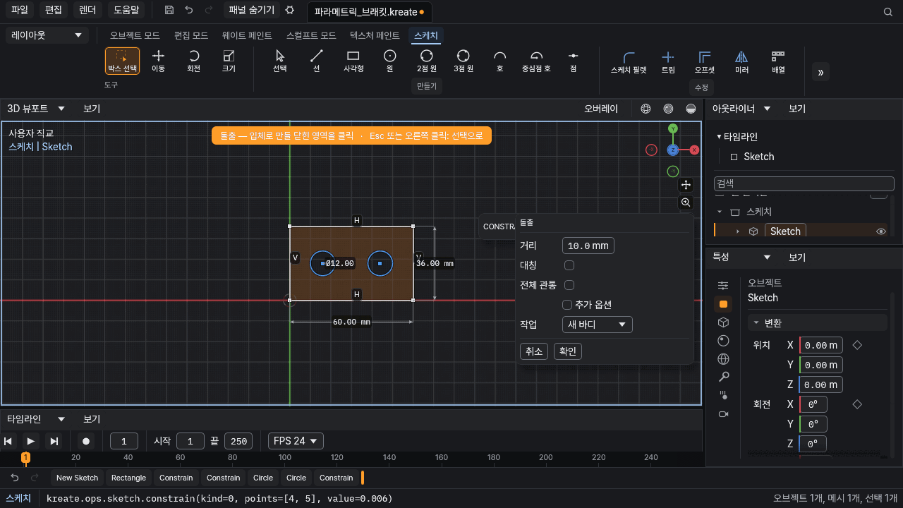
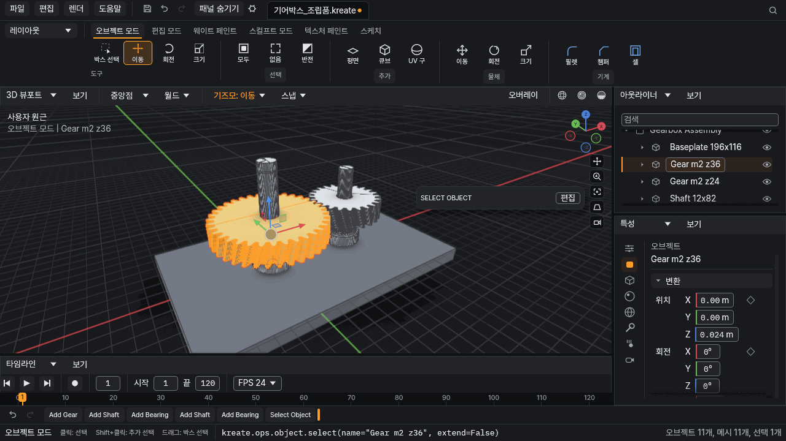
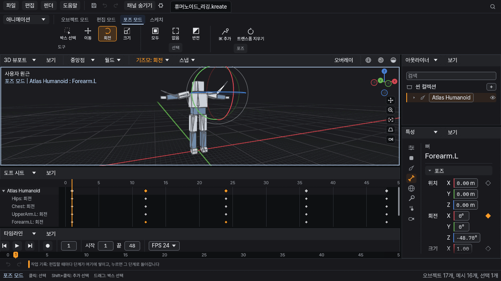
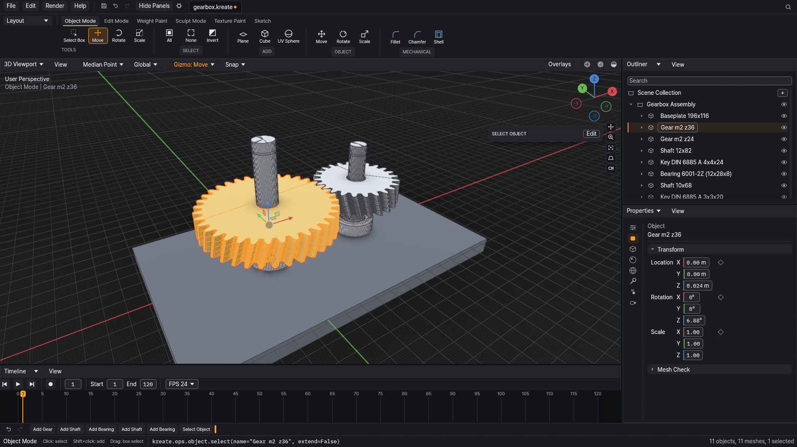
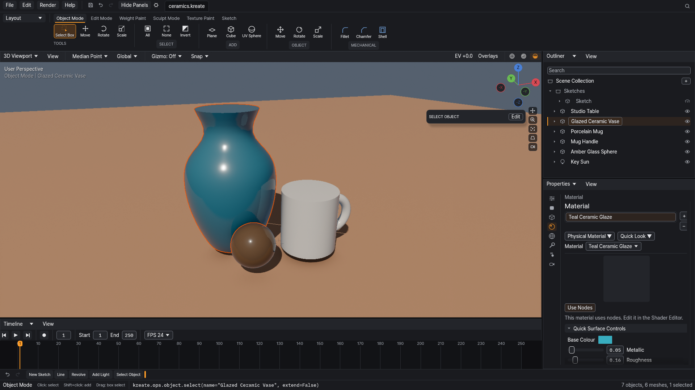
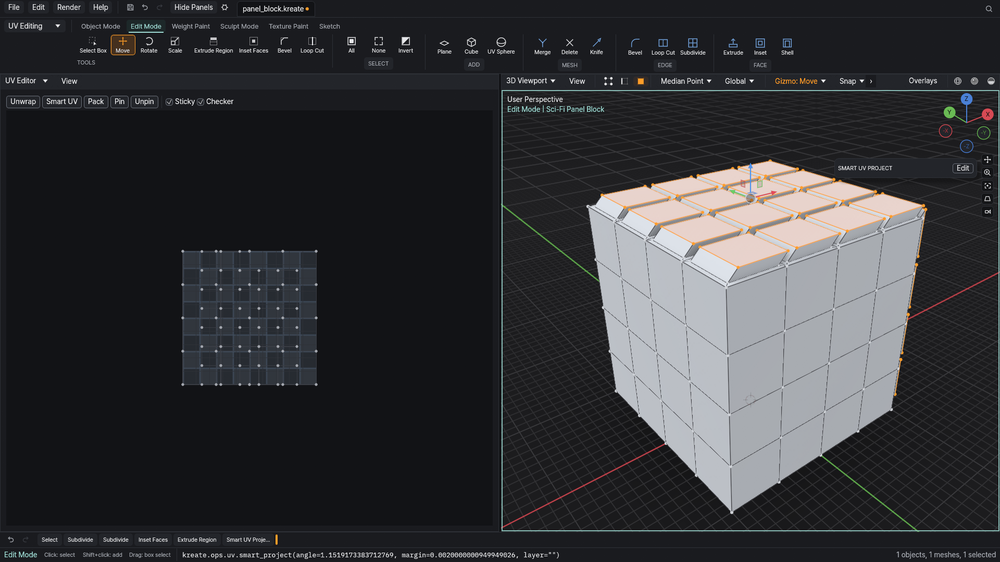
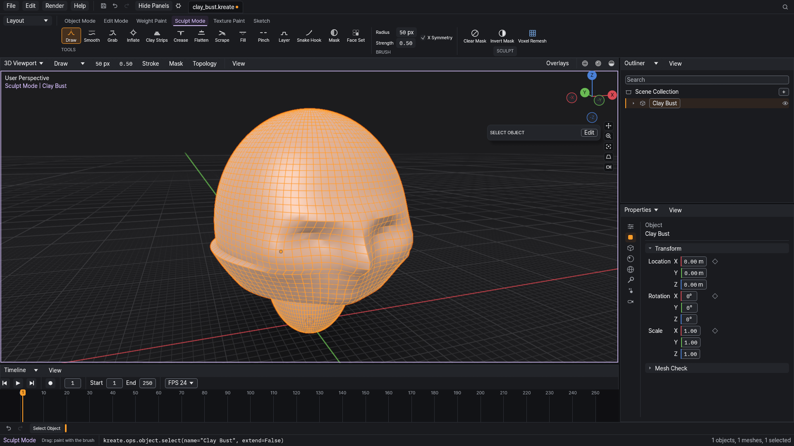
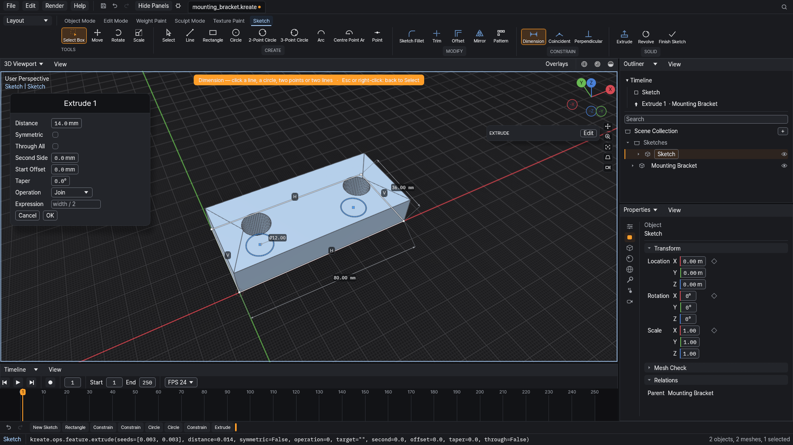
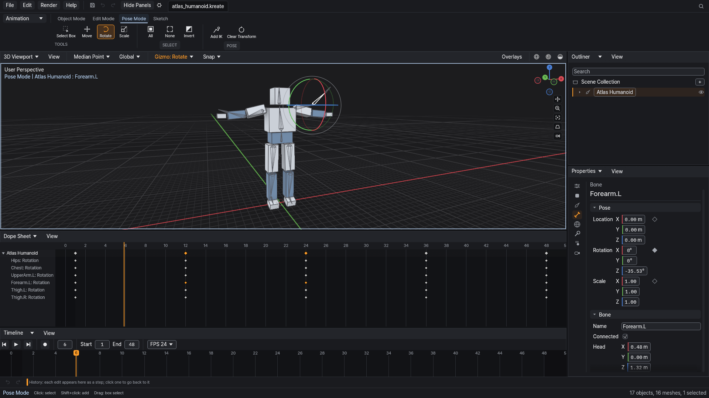

# Kreate

A 3D modelling, sculpting, parametric CAD and animation application written
from scratch in Rust (wgpu + egui), with a built-in connector that lets Claude
drive it.



## What it does

- **Model & CAD** — mesh editing with the usual operators (extrude, bevel, loop
  cut and more), parametric 2D sketching with dimensions and constraints, solid
  features (extrude, revolve, fillet, chamfer, shell), modifiers, and undo for
  everything.
- **Sculpt** — a full brush set (Clay Strips, Crease, Flatten, Snake Hook,
  Mask, Face Sets …), symmetry with 3D mirror preview, pen pressure, Voxel
  Remesh and dynamic topology.
- **Shade and render** — node-based materials with quick surface controls and
  procedural textures, and a path-traced render that runs the same node graphs
  as the viewport.
- **Rig and animate** — armatures, IK, bone constraints, Dope Sheet, timeline
  with custom FPS and rigid bodies. A robot read from URDF can be posed with an
  armature and exported moving.
- **Files** — glTF, OBJ, STL, FBX (rigged and animated), 3MF, PLY, OFF and
  STEP in; glTF, OBJ, STL, STEP and URDF out. Its own `.kreate` format is
  versioned so older releases can still read newer files.
- **Assets** — models, materials and HDRIs from your folders or Poly Haven.
- **AI connector** — `kreate-mcp` is an MCP server through which Claude can
  inspect and edit a running Kreate: add assets, sculpt to a reference,
  rig a character, check proportions.
- **Shared editing** — several people editing one scene live, through a
  relay (built in, or `kreate-relay` on an always-on machine).

## Motion & Screenshots

| Meshing Gear Assembly | Articulated Humanoid Rig |
|---|---|
|  |  |

| Mechanical Assembly | Path-Traced & Studio Materials |
|---|---|
|  |  |
| **Mesh & UV Editing** | **3D Sculpting with Symmetry** |
|  |  |
| **Parametric Sketch & CAD** | **Pose Mode & Dope Sheet** |
|  |  |

## Layout

| Path | What it is |
|---|---|
| `apps/kreate` | The desktop application |
| `apps/kreatec` | Command-line companion: convert, inspect and check files without a GPU |
| `apps/kreate-mcp` | MCP server that lets Claude drive a running Kreate |
| `apps/kreate-relay` | Standalone relay for shared editing |
| `crates/*` | Math, mesh, scene, operators, renderer, shaders, I/O, UI, collaboration … |

## Building

Requires Rust 1.94 or newer.

```sh
cargo run -p kreate --release      # the application
cargo run -p kreatec -- --help     # the command-line tool
cargo test --workspace
```

## Releases

Every change is recorded in [CHANGELOG.md](CHANGELOG.md); how versions are
numbered and cut is in [RELEASING.md](RELEASING.md).

## Supporting the work

Kreate is made by [MinaryHub](https://github.com/MinaryHub). If it is useful to
you, you can [sponsor the work](https://github.com/sponsors/MinaryHub) — no
features are locked behind it.

## License

Licensed under either of

- Apache License, Version 2.0 ([LICENSE-APACHE](LICENSE-APACHE))
- MIT license ([LICENSE-MIT](LICENSE-MIT))

at your option.
